# EcolePlus — guide d'utilisation

Pour le directeur, les enseignants et les personnes à qui le directeur a
donné des droits (économe, secrétaire, responsable de cantine).

> Les images sont celles de l'application (école d'essai « École Test »).
> Elles sont refaites automatiquement quand un écran change.

## 1. Les principes
- **Sans Internet, tout marche.** Ce que vous saisissez est gardé sur le
  téléphone, puis envoyé dès que le réseau revient. En haut de chaque écran :
  « Tout est synchronisé » ou « N éléments en attente ».
- **Chacun ne voit que ce qui le concerne.** Un enseignant ne voit que sa
  classe ; un économe ne voit que les finances.
- **Rien ne se perd.** On ne supprime pas un élève, une note ou un reçu : on
  le corrige ou on l'annule, et c'est noté.
- **Le micro** 🎤 permet de dicter dans les champs de texte (jamais dans les
  mots de passe).

## 2. L'accueil du directeur
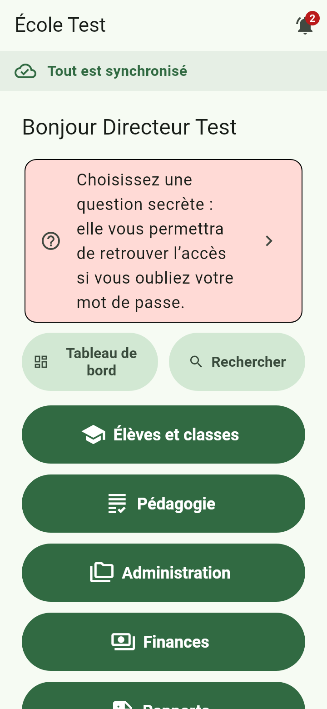

En haut : **Tableau de bord** (l'essentiel en un coup d'œil) et
**Rechercher**. La **cloche** 🔔 montre les notifications (appel à faire,
absents, paiements en retard…). Ensuite, 7 gros boutons :

| Bouton | Ce qu'on y trouve |
|---|---|
| Élèves et classes | élèves, classes, absences, appel, cartes scolaires, enseignants |
| Pédagogie | notes et classement, bulletins, emploi du temps, maternelle (si activée) |
| Administration | formulaires officiels, registres, archives |
| Finances | encaisser, reçus, caisse, toutes les finances, cantine (si activée) |
| Rapports | rapports PDF et Excel |
| Bibliothèque et IA | bibliothèque pédagogique, assistant IA |
| Mon école | fiche de l'école, années, options, personnes et droits, sécurité, sauvegarde |

## 3. Le tableau de bord
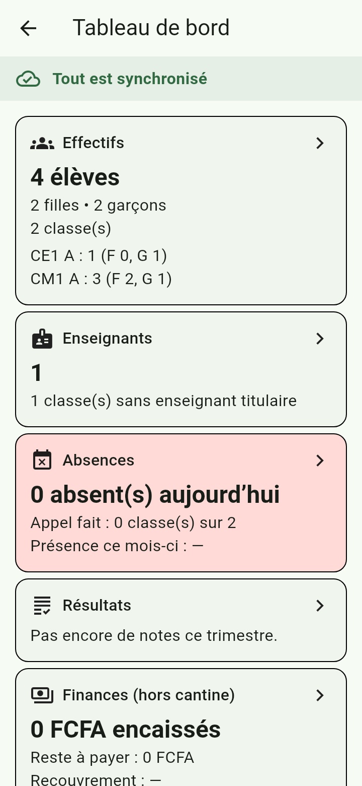

Effectifs (filles, garçons, par classe), enseignants, absences du jour et
appels faits, résultats du dernier trimestre, finances, formulaires de
l'année, espace de stockage, cantine (si activée), alertes. **Touchez une
carte** pour ouvrir l'écran détaillé.

## 4. Élèves et classes
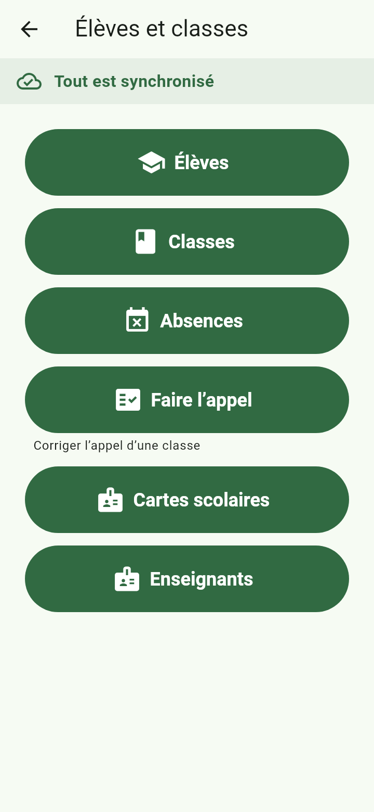
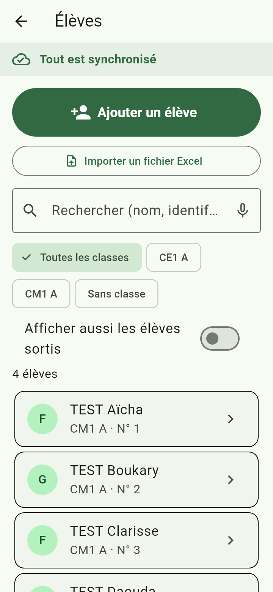

- **Ajouter un élève** : « Élèves » → « Ajouter » ; ou importer une liste
  Excel.
- **Fiche de l'élève** : identité, parents, classe, photo, fiche de
  scolarité.
- **Cartes scolaires** : 10 par page A4, avec photo.

## 5. L'appel du jour (enseignant, ou directeur pour corriger)
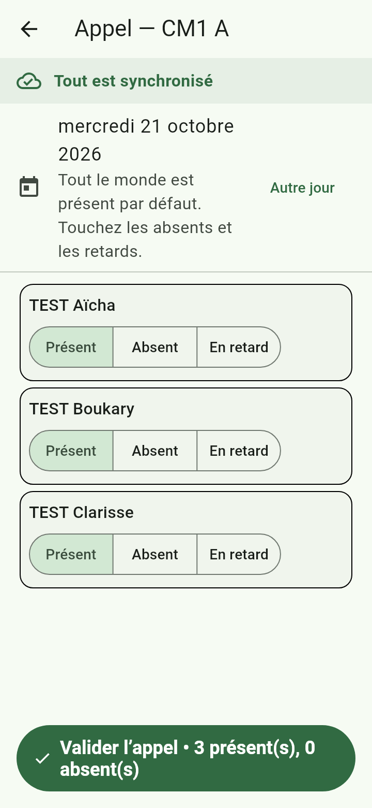

1. Accueil de l'enseignant → carte **« Ma journée »** → « Faire l'appel ».
2. **Tout le monde est présent par défaut.** Touchez « Absent » ou « En
   retard » pour les élèves concernés (motif facultatif, jamais de détail de
   santé).
3. « Valider l'appel ». ✅ « Appel fait (CM1 A) : 1 absent(s). »

Le directeur peut corriger l'appel de n'importe quelle classe, même un jour
passé (« Autre jour »). **Absences** : statistiques par classe et par élève
(jour, semaine, mois, depuis la rentrée), en PDF ou Excel.

## 6. Emploi du temps
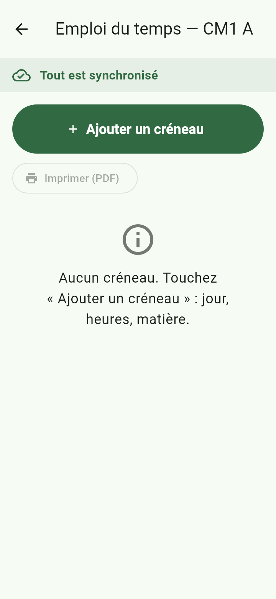

Pédagogie → Emploi du temps → la classe → « Ajouter un créneau » (jour,
heures « 7h30 », matière). Deux créneaux qui se chevauchent sont refusés.
« Copier vers une autre classe » et « Imprimer (PDF) ».

## 7. Notes, classement et bulletins
Pédagogie → Notes et classement → la classe → le trimestre. Saisie au
clavier ou **à la voix** (« Aïcha, quinze et demi »). Le classement, les
moyennes et les bulletins se calculent seuls ; les ex-aequo sont gérés.

## 8. Finances
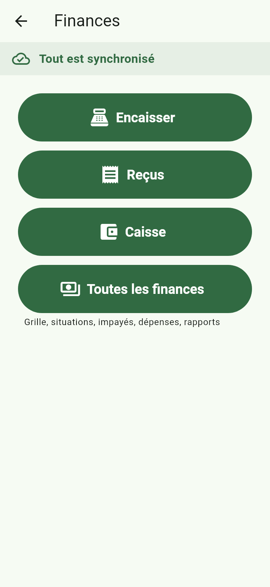

- **Encaisser** : choisir l'élève, cocher ce qu'il paie → reçu numéroté (PDF
  ou WhatsApp). Un reçu ne se modifie jamais : on l'annule si besoin.
- **Situation et impayés** : qui doit combien, relance prête à envoyer.
- **Caisse** : journal du jour, clôture.

## 9. Rapports
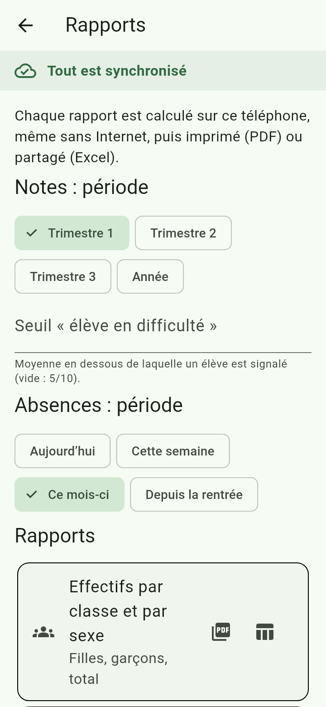

Choisissez le trimestre, le seuil « élève en difficulté » et la période des
absences, puis **PDF** (imprimer) ou **Excel** (partager) : effectifs par
classe et par sexe, listes, résultats par classe et par matière,
classements, absences, élèves en difficulté, finances, synthèse.

## 10. Recherche rapide
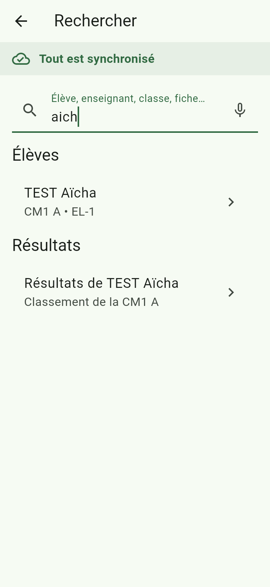

Tapez ou dictez 2 lettres au moins : élèves, enseignants, classes, vos
fiches de l'assistant, résultats, et même les écrans (« appel », « reçus »).

## 11. Notifications
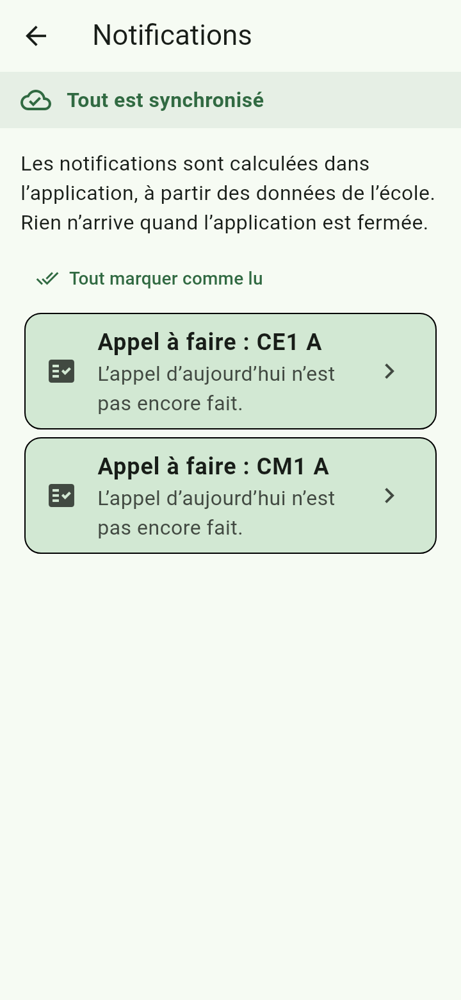

Calculées dans l'application à partir des données de l'école : appel à
faire, absents du jour, élève absent 3 fois ou plus dans le mois, paiements
en retard, stock bas de la cantine. « Tout marquer comme lu ». Rien n'arrive
quand l'application est fermée.

## 12. Assistant IA (enseignants et directeur)
Préparer un cours, des exercices, aider un élève en difficulté. Les noms des
élèves ne sont **jamais** envoyés. 30 demandes par mois et par enseignant
(réglable par le directeur). Relisez toujours la fiche avant de l'utiliser.

## 13. Sauvegarde et nouveau téléphone
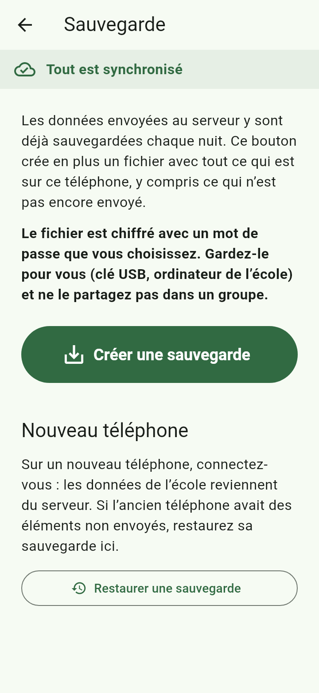

- Le serveur sauvegarde **chaque nuit** tout ce qui a été envoyé.
- « **Créer une sauvegarde** » : un fichier de ce téléphone, **chiffré avec
  un mot de passe** que vous choisissez (8 caractères au moins, notez-le).
- **Nouveau téléphone** : connectez-vous, les données reviennent du serveur.
  Si l'ancien téléphone avait des éléments non envoyés : « Restaurer une
  sauvegarde » → le fichier → le mot de passe → « Reprendre ».

## 14. Sécurité
- Chaque téléphone a un **code** (et l'empreinte si vous voulez).
- **Téléphone perdu** : Mon école → Sécurité → Téléphones de l'école →
  déconnecter. Ses données sont effacées à sa prochaine connexion.
- Choisissez une **question secrète** : elle permet de retrouver l'accès en
  cas d'oubli du mot de passe.
- Ne partagez jamais votre mot de passe ; donnez plutôt des **droits** à la
  personne (Mon école → Personnes et droits).

## 15. En cas de problème
| Problème | Que faire |
|---|---|
| « N éléments en attente » qui ne diminue pas | Vérifier Internet, puis toucher le bandeau → « Synchroniser maintenant » |
| « Accès refusé » | La personne n'a pas le droit : le directeur l'accorde dans « Personnes et droits » |
| Mot de passe oublié | « Mot de passe oublié » sur l'écran de connexion (question secrète), ou le directeur le réinitialise |
| Le téléphone a été changé | Se connecter sur le nouveau, puis « Restaurer une sauvegarde » si besoin |
